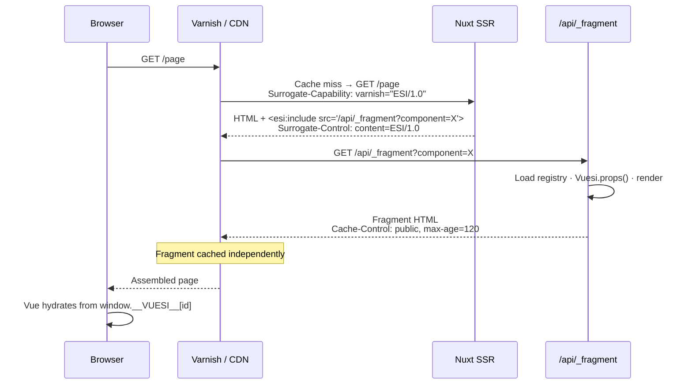

<div align="center">

# 🧩 VuESI

**Per-component edge caching for Nuxt — without giving up Vue.**

Cache individual components at the CDN layer. Each fragment gets its own TTL. Zero full-page invalidations.

[![CI][ci-src]][ci-href]
[![NPM version][npm-version-src]][npm-version-href]
[![NPM downloads][npm-downloads-src]][npm-downloads-href]
[![License][license-src]][license-href]
[![Nuxt][nuxt-src]][nuxt-href]
[![Node ≥22][node-src]][node-href]

</div>

---

## ✨ Why VuESI?

- **Component-level granularity** — each component gets its own `Cache-Control`. A header, a comment feed, a sidebar: separate TTLs, surgical invalidations.
- **One-line proxy setup** — one `useESI()` call is all it takes. VuESI emits `<esi:include>` tags and the `Surrogate-Control` header automatically, as soon as the proxy advertises `Surrogate-Capability: ESI/1.0`.
- **Hydration without re-fetch** — props are injected via `window.__VUESI__[id]` on the first response. Vue picks up server state without an extra network round-trip.
- **Works with Varnish, Nginx, Fastly** — any reverse proxy supporting ESI/1.0 works once it sends `Surrogate-Capability`.

---

## 🚀 Quickstart

```bash
# 1. Install
yarn add @jamyouss/vuesi
```

```ts
// nuxt.config.ts — 2. Register the module
export default defineNuxtConfig({
  modules: ['@jamyouss/vuesi']
})
```

```bash
# 3. (optional) Run Varnish locally for end-to-end ESI testing
cp docker-compose.yml.dist docker-compose.yml && docker-compose up
```

---

## 🏗️ Architecture



---

## 📦 Features

| Feature | Detail |
|---|---|
| Automatic `<esi:include>` | Emitted server-side by `useESI()`, transparent to the rest of the app |
| Per-fragment Cache-Control | Each component declares its own TTL via `Vuesi.cacheControl` |
| Optimized hydration | Props serialized into an inline script — no re-fetch on client mount |
| Auto-generated registry | Components scanned at build time; only Nuxt auto-imported components are exposed |
| Error resilience | `onerror="continue"` enabled by default — a fragment error won't break the page |
| Docker + Varnish included | `docker-compose.yml.dist` ready to use for local ESI testing |

---

## 📖 Usage

### 1. ESI component

Export a `Vuesi` object from any component you want independently cached. `props()` runs server-side on every fragment render.

```vue
<!-- components/Welcome.vue -->
<template>
  <p>Hello {{ username }}</p>
</template>

<script lang="ts">
import type { FragmentData } from '@jamyouss/vuesi'

export const Vuesi: FragmentData = {
  cacheControl: 'public, max-age=120',
  props: async () => {
    const user = await $fetch('https://api.example.com/users/1')
    return { username: user.name }
  }
}
</script>

<script setup lang="ts">
defineProps<{ username: string }>()
</script>
```

### 2. Use it in a page

```vue
<template>
  <WelcomeESI />
</template>

<script setup lang="ts">
import { useESI, resolveComponent } from '#imports'

const WelcomeESI = useESI('Welcome', resolveComponent('Welcome'))
</script>
```

`useESI(name, component)` returns a component that:
- emits `<esi:include>` on the **server** when the request comes through an ESI-capable surrogate, and renders the component inline otherwise
- hydrates via `window.__VUESI__[id]` on the **client**

> [!NOTE]
> The first argument must match the PascalCase name as registered by Nuxt (`'Welcome'`, `'Comments'`…).

### 3. Reverse proxy

VuESI only emits `<esi:include>` when the request advertises ESI support through the [`Surrogate-Capability`](https://www.w3.org/TR/edge-arch/) header (any device token, value containing `ESI/1.0`). It then sets the `Surrogate-Control: content=ESI/1.0` response header itself.

With Varnish, add this to `vcl_recv`:

```vcl
set req.http.Surrogate-Capability = "varnish=ESI/1.0";
```

Without that header (direct access to Nuxt, dev server, proxy without ESI), components are rendered inline like regular SSR, so the page stays complete instead of shipping raw `<esi:include>` tags the browser would ignore. A private component (`cacheControl` with `private`, `no-store` or `no-cache`) rendered inline also downgrades the page's `Cache-Control` to its own value.

Sending `x-vuesi-enabled: false` forces inline rendering even through an ESI-capable surrogate.

To develop locally with Varnish:

```bash
cp docker-compose.yml.dist docker-compose.yml
docker-compose up
# App available through Varnish at http://localhost:8080
```

---

## ⚙️ Configuration

```ts
// nuxt.config.ts
export default defineNuxtConfig({
  modules: ['@jamyouss/vuesi'],
  vuesi: {
    enabled: true,                  // Set to false for classic SSR (dev/test)
    fragmentPath: '/api/_fragment', // Fragment endpoint path
    ignoreErrors: true              // onerror="continue" on <esi:include> tags
  }
})
```

| Option | Type | Default | Description |
|---|---|---|---|
| `enabled` | `boolean` | `true` | Enable/disable ESI tag generation |
| `fragmentPath` | `string` | `/api/_fragment` | Fragment endpoint URL path |
| `ignoreErrors` | `boolean` | `true` | Adds `onerror="continue"` to `<esi:include>` tags |

---

## 🔒 Security

> [!WARNING]
> **Props in URLs** — props passed to an ESI-wrapped component are serialized into the fragment query string (visible in proxy logs and cache keys). Never pass sensitive data as props. Use `Vuesi.props()` to fetch confidential data server-side instead.

**Closed registry** — only components registered by Nuxt's auto-import are accessible through the fragment endpoint. Arbitrary file paths are rejected.

---

## 📚 API

### `useESI(name, component)`

```ts
function useESI(name: string, component: Component): Component
```

| Parameter | Type | Description |
|---|---|---|
| `name` | `string` | PascalCase component name as registered by Nuxt |
| `component` | `Component` | Resolved component instance via `resolveComponent()` |

### `FragmentData`

```ts
interface FragmentData {
  cacheControl?: string                          // HTTP Cache-Control for this fragment
  props: () => Promise<Record<string, unknown>>  // Server-side data fetcher
}
```

---

## 🛠️ Development

```bash
yarn install        # Install dependencies
yarn dev:prepare    # Generate stubs + prepare playground
yarn dev            # Start playground with hot-reload
yarn lint           # Run ESLint
yarn test           # Run Vitest (unit + e2e)
yarn prepack        # Build the module
```

---

## 📄 License

[MIT](./LICENSE) © [jamyouss](https://github.com/jamyouss)

<!-- Badges -->
[ci-src]: https://img.shields.io/github/actions/workflow/status/jamyouss/vuesi/ci.yml?branch=main&style=flat&colorA=18181B&colorB=28CF8D&label=CI
[ci-href]: https://github.com/jamyouss/vuesi/actions/workflows/ci.yml

[npm-version-src]: https://img.shields.io/npm/v/@jamyouss/vuesi?style=flat&colorA=18181B&colorB=28CF8D
[npm-version-href]: https://npmjs.com/package/@jamyouss/vuesi

[npm-downloads-src]: https://img.shields.io/npm/dm/@jamyouss/vuesi?style=flat&colorA=18181B&colorB=28CF8D
[npm-downloads-href]: https://npmjs.com/package/@jamyouss/vuesi

[license-src]: https://img.shields.io/npm/l/@jamyouss/vuesi?style=flat&colorA=18181B&colorB=28CF8D
[license-href]: https://github.com/jamyouss/vuesi/blob/main/LICENSE

[nuxt-src]: https://img.shields.io/badge/Nuxt-18181B?logo=nuxt.js
[nuxt-href]: https://nuxt.com

[node-src]: https://img.shields.io/node/v/@jamyouss/vuesi?style=flat&colorA=18181B&colorB=28CF8D
[node-href]: https://nodejs.org
