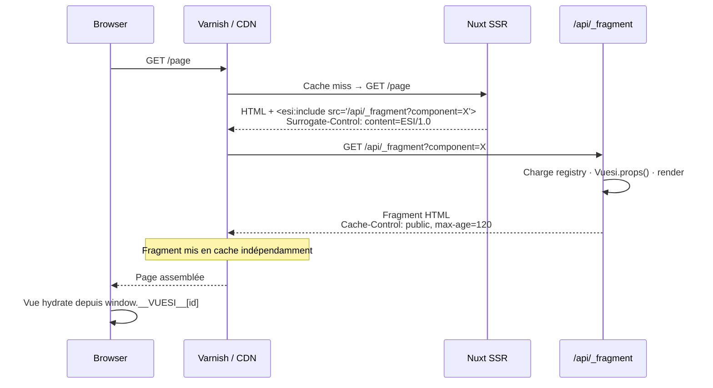

<div align="center">

# 🧩 VuESI

**Per-component edge caching for Nuxt — without giving up Vue.**

Cache individual components at the CDN layer. Each fragment gets its own TTL. Zero full-page invalidations.

[![CI][ci-src]][ci-href]
[![NPM version][npm-version-src]][npm-version-href]
[![NPM downloads][npm-downloads-src]][npm-downloads-href]
[![License][license-src]][license-href]
[![Nuxt][nuxt-src]][nuxt-href]
[![Node ≥22][node-src]][node-href]

</div>

---

## ✨ Pourquoi VuESI ?

- **Granularité maximale** — chaque composant a son propre `Cache-Control`. Un header, un fil de commentaires, une sidebar : TTL distincts, invalidations chirurgicales.
- **Zéro code côté proxy** — un seul `useESI()` suffit. VuESI génère les tags `<esi:include>` et l'en-tête `Surrogate-Control` automatiquement.
- **Hydratation sans re-fetch** — les props sont injectées via `window.__VUESI__[id]` à la première réponse. Vue reprend la main sans appel réseau supplémentaire.
- **Compatible Varnish, Nginx, Fastly** — tout reverse proxy supportant ESI/1.0 fonctionne sans configuration spécifique.

---

## 🚀 Quickstart

```bash
# 1. Installer
yarn add @jamyouss/vuesi

# 2. Déclarer le module
```

```ts
// nuxt.config.ts
export default defineNuxtConfig({
  modules: ['@jamyouss/vuesi']
})
```

```bash
# 3. (optionnel) Lancer Varnish en local pour tester l'ESI de bout en bout
cp docker-compose.yml.dist docker-compose.yml && docker-compose up
```

---

## 🏗️ Architecture



---

## 📦 Fonctionnalités

| Fonctionnalité | Détail |
|---|---|
| `<esi:include>` automatique | Généré côté serveur par `useESI()`, transparent pour le reste de l'app |
| Cache-Control par fragment | Chaque composant déclare son propre TTL via `Vuesi.cacheControl` |
| Hydratation optimisée | Props sérialisées en inline script — pas de re-fetch au montage client |
| Registry auto-généré | Scan des composants au build ; seuls les composants Nuxt auto-importés sont exposés |
| Gestion des erreurs | `onerror="continue"` activé par défaut — une erreur de fragment ne casse pas la page |
| Docker + Varnish inclus | `docker-compose.yml.dist` prêt à l'emploi pour tester en local |

---

## 📖 Usage

### 1. Composant ESI

Exporter un objet `Vuesi` depuis le composant à cacher. `props()` est appelé côté serveur à chaque rendu du fragment.

```vue
<!-- components/Welcome.vue -->
<template>
  <p>Bonjour {{ username }}</p>
</template>

<script lang="ts">
import type { FragmentData } from '@jamyouss/vuesi'

export const Vuesi: FragmentData = {
  cacheControl: 'public, max-age=120',
  props: async () => {
    const user = await $fetch('https://api.example.com/users/1')
    return { username: user.name }
  }
}
</script>

<script setup lang="ts">
defineProps<{ username: string }>()
</script>
```

### 2. Utilisation dans une page

```vue
<template>
  <WelcomeESI />
</template>

<script setup lang="ts">
import { useESI, resolveComponent } from '#imports'

const WelcomeESI = useESI('Welcome', resolveComponent('Welcome'))
</script>
```

`useESI(name, component)` retourne un composant qui :
- émet `<esi:include>` côté **serveur**
- hydrate via `window.__VUESI__[id]` côté **client**

> [!NOTE]
> Le premier argument doit correspondre au nom PascalCase tel qu'enregistré par Nuxt (`'Welcome'`, `'Comments'`…).

### 3. Reverse proxy

Tout proxy compatible ESI/1.0 fonctionne sans configuration supplémentaire. VuESI pose lui-même l'en-tête `Surrogate-Control: content=ESI/1.0`.

Pour développer en local avec Varnish :

```bash
cp docker-compose.yml.dist docker-compose.yml
docker-compose up
# App disponible via Varnish sur http://localhost:8080
```

---

## ⚙️ Configuration

```ts
// nuxt.config.ts
export default defineNuxtConfig({
  modules: ['@jamyouss/vuesi'],
  vuesi: {
    enabled: true,            // Désactiver pour le rendu classique (dev/test)
    fragmentPath: '/api/_fragment', // Chemin du endpoint fragment
    ignoreErrors: true        // onerror="continue" sur les <esi:include>
  }
})
```

| Option | Type | Défaut | Description |
|---|---|---|---|
| `enabled` | `boolean` | `true` | Active/désactive la génération des tags ESI |
| `fragmentPath` | `string` | `/api/_fragment` | URL du endpoint fragment |
| `ignoreErrors` | `boolean` | `true` | Ajoute `onerror="continue"` aux `<esi:include>` |

---

## 🔒 Sécurité

> [!WARNING]
> **Props dans les URLs** — les props passées à un composant ESI sont sérialisées dans la query string du fragment (visibles dans les logs proxy et les clés de cache). Ne pas y mettre de données sensibles. Utiliser `Vuesi.props()` pour fetcher les données confidentielles côté serveur.

**Registry fermé** — seuls les composants enregistrés par l'auto-import Nuxt sont accessibles via le endpoint fragment. Les chemins de fichiers arbitraires sont rejetés.

---

## 📚 API

### `useESI(name, component)`

```ts
function useESI(name: string, component: Component): Component
```

| Paramètre | Type | Description |
|---|---|---|
| `name` | `string` | Nom PascalCase du composant (auto-import Nuxt) |
| `component` | `Component` | Instance résolue via `resolveComponent()` |

### `FragmentData`

```ts
interface FragmentData {
  cacheControl?: string                          // Cache-Control du fragment
  props: () => Promise<Record<string, unknown>>  // Données serveur du composant
}
```

---

## 🛠️ Développement

```bash
yarn install        # Dépendances
yarn dev:prepare    # Stubs + prepare playground
yarn dev            # Playground avec hot-reload
yarn lint           # ESLint
yarn test           # Vitest (unit + e2e)
yarn prepack        # Build du module
```

---

## 📄 Licence

[MIT](./LICENSE) © [jamyouss](https://github.com/jamyouss)

<!-- Badges -->
[ci-src]: https://img.shields.io/github/actions/workflow/status/jamyouss/vuesi/ci.yml?branch=main&style=flat&colorA=18181B&colorB=28CF8D&label=CI
[ci-href]: https://github.com/jamyouss/vuesi/actions/workflows/ci.yml

[npm-version-src]: https://img.shields.io/npm/v/@jamyouss/vuesi?style=flat&colorA=18181B&colorB=28CF8D
[npm-version-href]: https://npmjs.com/package/@jamyouss/vuesi

[npm-downloads-src]: https://img.shields.io/npm/dm/@jamyouss/vuesi?style=flat&colorA=18181B&colorB=28CF8D
[npm-downloads-href]: https://npmjs.com/package/@jamyouss/vuesi

[license-src]: https://img.shields.io/npm/l/@jamyouss/vuesi?style=flat&colorA=18181B&colorB=28CF8D
[license-href]: https://github.com/jamyouss/vuesi/blob/main/LICENSE

[nuxt-src]: https://img.shields.io/badge/Nuxt-18181B?logo=nuxt.js
[nuxt-href]: https://nuxt.com

[node-src]: https://img.shields.io/node/v/@jamyouss/vuesi?style=flat&colorA=18181B&colorB=28CF8D
[node-href]: https://nodejs.org
